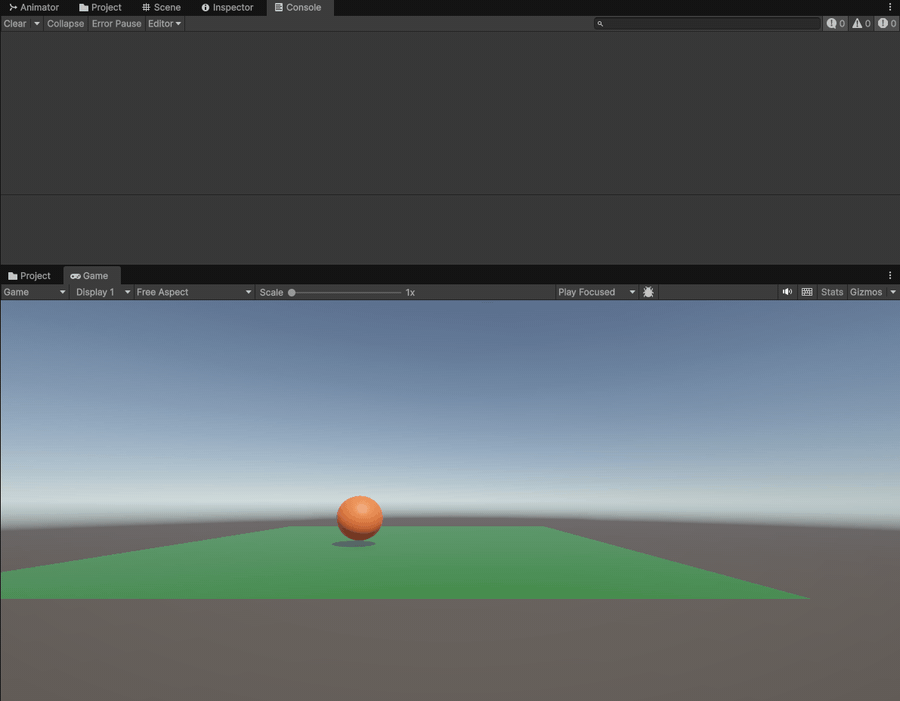
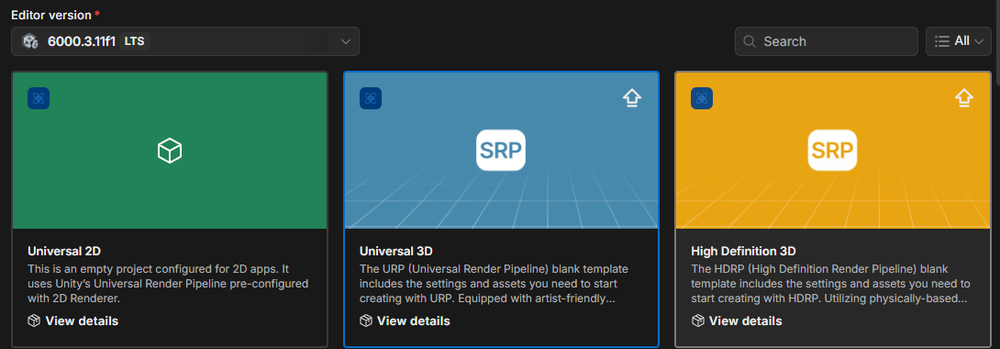
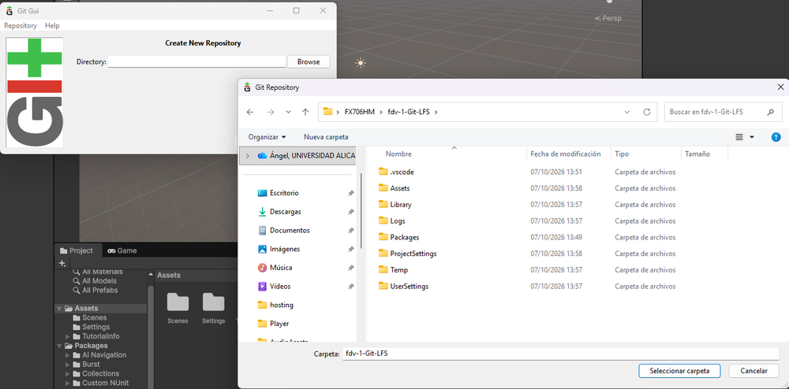
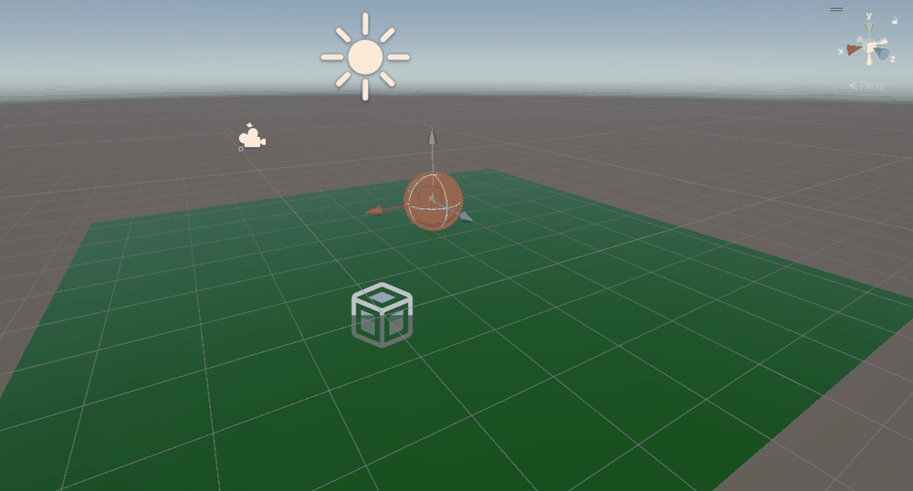
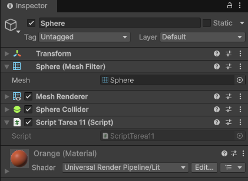
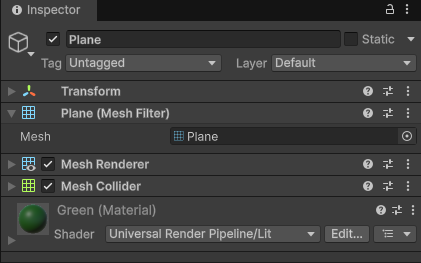
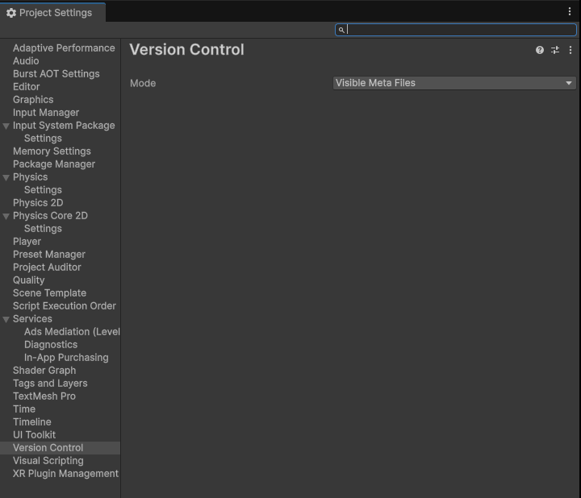
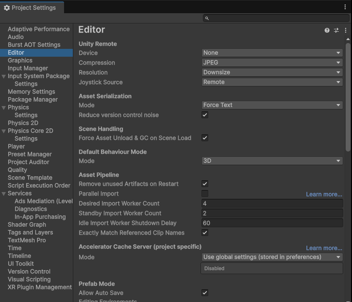
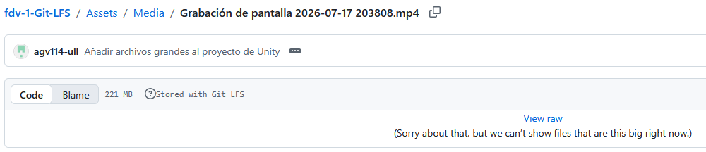

# Práctica 1.1 · Uso de Git LFS

**Fundamentos del Desarrollo de Videojuegos** · Máster Universitario en Desarrollo de Videojuegos · Universidad de La Laguna · Curso 2026-27
**Autor:** Ángel Gonjar Verdejo



## Objetivo

Versionar un proyecto Unity con Git y gestionar sus ficheros de gran tamaño mediante Git LFS.

## 1. Proyecto Unity y repositorio Git

Se creó un proyecto Unity 3D con la plantilla Universal 3D y se añadieron a la escena dos objetos 3D, un plano y una esfera. Siguiendo el flujo de trabajo de Unity, cada objeto tiene su propio material: *Green* para el plano y *Orange* para la esfera (figuras 3 a 5).

El proyecto está configurado para el control de versiones con *Visible Meta Files* y serialización de recursos en *Force Text* (figuras 6 y 7). Se versiona en un repositorio Git local, creado con Git GUI y conectado a un repositorio remoto en GitHub, que incluye el fichero `.gitignore` de Unity (figuras 1 y 2).

## 2. Git LFS

Git LFS se configuró mediante el fichero `.gitattributes` de Unity, que indica qué tipos de fichero se almacenan en LFS: vídeo, audio, imágenes y modelos 3D, entre otros.

En una segunda versión del proyecto se incorporaron:

- Un vídeo de 232 MB en la carpeta `Assets/Media`, almacenado mediante Git LFS (figura 8).
- El script `ScriptTarea11`, asignado a la esfera, que muestra el mensaje «Script tarea 1.1» en la consola y en pantalla (animación inicial).

## Verificación

Los ficheros de vídeo figuran entre los gestionados por Git LFS:

```text
$ git lfs ls-files
95fe8f503f * Assets/Media/Grabación de pantalla 2026-07-17 203808.mp4
8a71c076bc * Assets/Media/Grabación de pantalla 2026-09-11 200212.mp4
```

En GitHub, el vídeo de 232 MB aparece con la indicación «Stored with Git LFS» (figura 8).

## Capturas del proceso



*Figura 1. Creación del proyecto en Unity Hub con la plantilla Universal 3D.*



*Figura 2. Creación del repositorio local con Git GUI.*



*Figura 3. Escena con los dos objetos 3D.*



*Figura 4. Esfera: material Orange y script `ScriptTarea11`.*



*Figura 5. Plano: material Green.*



*Figura 6. Control de versiones en modo Visible Meta Files.*



*Figura 7. Serialización de recursos en Force Text.*



*Figura 8. El vídeo en GitHub, almacenado con Git LFS.*

## Herramientas

Unity 6000.5.11f1 (URP) · Git · Git LFS · Git GUI · GitHub Desktop

## Referencias

- Plantilla `.gitignore` de Unity: [github/gitignore](https://github.com/github/gitignore/blob/main/Unity.gitignore).
- Plantilla `.gitattributes` de Unity: [gitattributes/gitattributes](https://github.com/gitattributes/gitattributes/blob/master/Unity.gitattributes).
- Guion de la práctica y material de la asignatura (campus virtual de la ULL).
