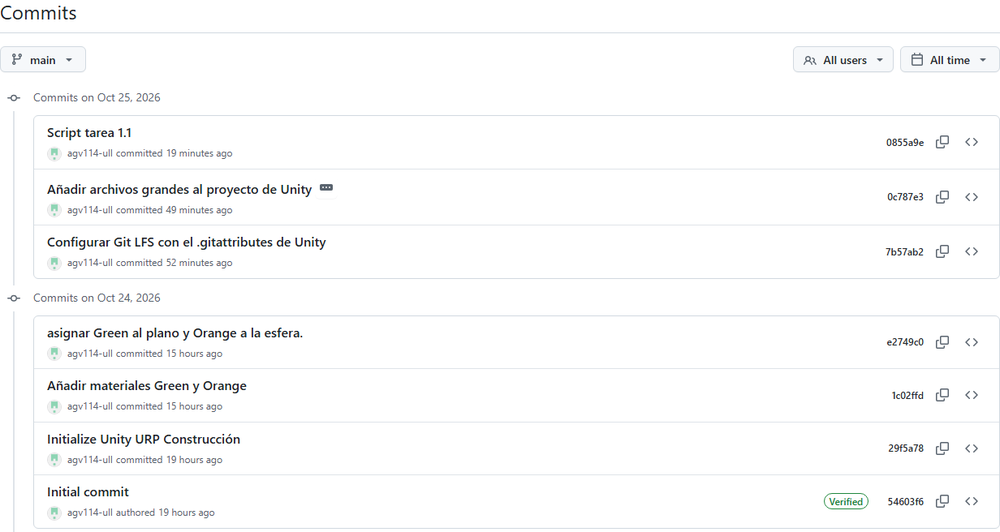

# Práctica 1.1 · Uso de Git LFS

**Fundamentos del Desarrollo de Videojuegos** · Máster Universitario en Desarrollo de Videojuegos · Universidad de La Laguna · Curso 2026-27
**Autor:** Ángel Gonjar Verdejo


## Objetivo

Versionar un proyecto Unity con Git y gestionar sus ficheros de gran tamaño mediante Git LFS.

## 1. Proyecto Unity y repositorio Git

Se creó un proyecto Unity con la plantilla Universal 3D (URP) y se añadieron a la escena dos objetos 3D, un plano y una esfera (figura 1). Siguiendo el flujo de trabajo de Unity, se crearon los materiales *Green* y *Orange* en `Assets/Materials` y se asignaron al plano y a la esfera, respectivamente (figuras 2 y 3).

El proyecto está configurado para el control de versiones con *Visible Meta Files* y serialización de recursos en *Force Text* (figuras 4 y 5). Se versiona en un repositorio Git local, gestionado con GitHub Desktop y conectado a un repositorio remoto en GitHub, que incluye el fichero `.gitignore` de Unity.

## 2. Git LFS

Se habilitó Git LFS en el repositorio y se añadió el fichero `.gitattributes` de Unity, que indica qué tipos de fichero se almacenan en LFS: vídeo, audio, imágenes y modelos 3D, entre otros. El fichero se incorporó en un commit anterior al del vídeo, de modo que el vídeo se almacena en LFS desde su primera versión.

En una segunda versión del proyecto se incorporaron:

- Un vídeo de 232 MB en la carpeta `Assets/Media`, almacenado mediante Git LFS (figura 6).
- El script `ScriptTarea11`, asignado a la esfera, que muestra el mensaje «Script tarea 1.1» en la consola y en pantalla (animación inicial).

La figura 7 muestra el historial de commits del repositorio.

## Verificación

El vídeo figura entre los ficheros gestionados por Git LFS:

```text
$ git lfs ls-files
95fe8f503f * Assets/Media/Grabación de pantalla 2026-07-17 203808.mp4
```

En GitHub, el vídeo aparece con la indicación «Stored with Git LFS» (figura 6).

## Capturas del proceso


*Figura 1. Escena con los dos objetos 3D.*


*Figura 2. Esfera: material Orange y script `ScriptTarea11`.*


*Figura 3. Plano: material Green.*


*Figura 4. Control de versiones en modo Visible Meta Files.*


*Figura 5. Serialización de recursos en Force Text.*


*Figura 6. El vídeo en GitHub, almacenado con Git LFS.*



*Figura 7. Historial de commits del repositorio.*

## Herramientas

Unity 6000.5.11f1 (URP) · Git · Git LFS · GitHub Desktop

## Referencias

- Plantilla `.gitignore` de Unity: generada con [gitignore.io](https://www.toptal.com/developers/gitignore/api/unity) a partir de [github/gitignore](https://github.com/github/gitignore/blob/main/Unity.gitignore).
- Plantilla `.gitattributes` de Unity: [gitattributes/gitattributes](https://github.com/gitattributes/gitattributes/blob/master/Unity.gitattributes).
- Guion de la práctica y material de la asignatura (campus virtual de la ULL).
